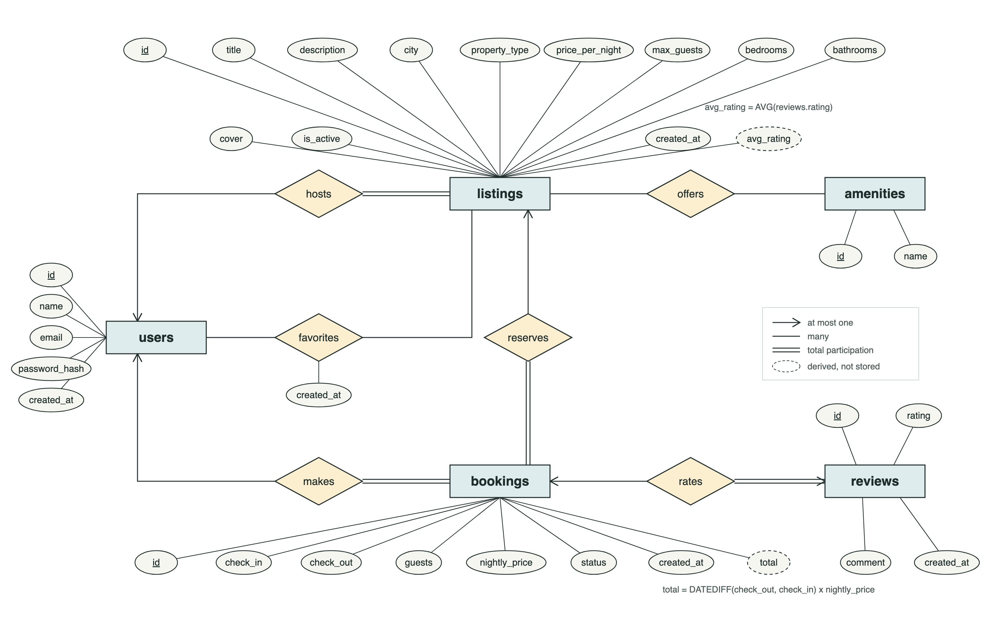

# COMP3278 Group Project - Lantern Stays

A short-stay booking web app (in the spirit of Airbnb) backed by MySQL: guests search, book, change, cancel and review stays; hosts manage their listings. A built-in SQL inspector shows the SQL statements behind every action.

This repository contains two implementations of the same app, with the same database design and the same hand-written SQL:

| Folder | Stack | Needs | Start here |
| --- | --- | --- | --- |
| [`lantern-stays-v2/`](lantern-stays-v2/) | TypeScript, Fastify, React (Vite), MySQL; automated tests | Node.js 22.12+ (20.19+ also works), MySQL 8.0+ | [README](lantern-stays-v2/README.md) |
| [`lantern-stays/`](lantern-stays/) | JavaScript, Express, plain HTML/CSS/JS, MySQL; no build step | Node.js 18+, MySQL 8.0+ | [README](lantern-stays/README.md) |

Each folder is self-contained. To run one, open its README and follow the steps (`npm install`, create `.env`, `npm run db:setup`, `npm start`).

## Database

- ER diagram: [`lantern-stays-v2/docs/er-diagram.png`](lantern-stays-v2/docs/er-diagram.png)
- Schema and initial data: [`lantern-stays-v2/db/schema.sql`](lantern-stays-v2/db/schema.sql), [`lantern-stays-v2/db/seed.sql`](lantern-stays-v2/db/seed.sql)
- Key SQL statements explained: [`lantern-stays-v2/docs/key-sql.md`](lantern-stays-v2/docs/key-sql.md)

