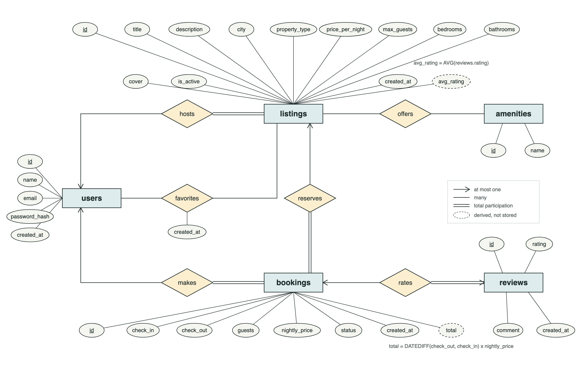

# Lantern Stays

COMP3278 final project: a short-stay booking web app (in the spirit of Airbnb).

**Stack:** TypeScript end to end, **MySQL** with hand-written SQL, **Fastify** API server, **React** front end built with Vite.

Guests search for places that are free on their dates, book them, change or cancel bookings, review finished stays and save favourites. Hosts publish listings, edit, pause or delete them, and see bookings and revenue per listing. A built-in **SQL inspector** shows the SQL statements behind browsing and changes to listings and bookings.

---

## 1. Requirements

| Software | Version | Check with |
| --- | --- | --- |
| Node.js | 22.12+ on Node 22, Node 24, or Node 26+ | `node -v` |
| MySQL Server | 8.0 or newer (running) | `mysql --version` |

Tested with Node.js 22.22.3 and MySQL 8.0.46. Nothing else is needed; the app works offline once `npm install` has finished.

## 2. Installation and run instructions

Run every command from this project folder (the one containing `package.json`).

**Step 1 - install the dependencies**

```bash
npm install
```

**Step 2 - create the configuration file**

```bash
cp .env.example .env
```

On Windows use `copy .env.example .env`. Then open `.env` and put your MySQL password after `DB_PASSWORD=` (see [section 3](#3-database-setup-configuration-and-initial-data) for all settings).

**Step 3 - create the database and load the initial data**

```bash
npm run db:setup
```

Expected output:

```text
Connecting to MySQL at 127.0.0.1:3306 as "root" ...
  ran db/schema.sql
  ran db/seed.sql

Database "lantern_stays_v2" is ready:
  users                8 rows
  listings            21 rows
  amenities           12 rows
  listing_amenities  109 rows
  bookings            43 rows
  reviews             24 rows
  favorites           11 rows
```

**Step 4 - start the app**

```bash
npm start
```

This first compiles the app (a few seconds) and then prints `Lantern Stays is running at http://localhost:3000`. Open that address. Stop the server with `Ctrl + C`.

**Step 5 - log in with a demo account**

Click **Log in** and press one of the demo buttons, or type the details yourself:

| Role in the demo | Email | Password |
| --- | --- | --- |
| Guest with past and upcoming trips | `alice@example.com` | `lantern123` |
| Host with five listings | `ben@example.com` | `lantern123` |

All eight seeded accounts (`alice`, `ben`, `chloe`, `daniel`, `emma`, `farid`, `grace`, `hiro` `@example.com`) use the same password. You can also create a new account with **Sign up**.

### Other commands

| Command | What it does |
| --- | --- |
| `npm test` | Runs the automated API tests against a separate database (`lantern_stays_v2_test`), so your data is untouched |
| `npm run dev` | Development mode with live reload: open <http://localhost:5173> |
| `npm run typecheck` | Type-checks the server and the front end |
| `npm run db:setup -- --reset` | Rebuilds the demo database and reloads the initial data |

## 3. Database setup, configuration and initial data

### Configuration (`.env`)

| Setting | Default | Meaning |
| --- | --- | --- |
| `PORT` | `3000` | Port of the web server |
| `DB_HOST` | `127.0.0.1` | MySQL host |
| `DB_PORT` | `3306` | MySQL port |
| `DB_USER` | `root` | MySQL account (needs permission to create a database) |
| `DB_PASSWORD` | *(empty)* | Password of that account |
| `DB_NAME` | `lantern_stays_v2` | Name of the database to create and use |
| `SESSION_SECRET` | sample text | Signs the login cookie; any text of 32 characters or more |
| `SQL_INSPECTOR` | `true` | Set to `false` to stop sending executed SQL to the browser |

The settings are validated when the app starts; a wrong value is reported by name.

### What `npm run db:setup` does

It initializes the database selected by `DB_NAME` using the account from `.env`. If that database already contains tables, pass `--reset` to replace its demo data.

1. [`db/schema.sql`](db/schema.sql) - `CREATE DATABASE IF NOT EXISTS lantern_stays_v2`, then drops and recreates the tables and the view.
2. [`db/seed.sql`](db/seed.sql) - inserts the initial data.

### Alternative: set up with the `mysql` client

For manual setup, use these files only with a database dedicated to this version. They target the default database `lantern_stays_v2` and replace its existing demo data. For a custom database, use `npm run db:setup` with `DB_NAME` set.

```bash
mysql -u root -p < db/schema.sql
mysql -u root -p < db/seed.sql
```

In Windows PowerShell (which has no `<` redirection), use:

```bash
mysql -u root -p -e "source db/schema.sql; source db/seed.sql"
```

### Initial data

| Table | Rows | Contents |
| --- | --- | --- |
| `users` | 8 | 4 hosts and 4 guests (any account can do both) |
| `listings` | 21 | Hong Kong 6, Tokyo 4, Seoul 3, Taipei 3, Bangkok 3, Singapore 2 |
| `amenities` | 12 | Wifi, Kitchen, Pool, Sea view, ... |
| `listing_amenities` | 109 | Which listing offers which amenity |
| `bookings` | 43 | Past, upcoming and cancelled stays |
| `reviews` | 24 | One per finished stay (one stay is left unreviewed on purpose) |
| `favorites` | 11 | Saved listings |
| `sessions` | 0 | Login sessions; filled as people log in |

All dates in the seed file are **relative to the day you load it** (`CURDATE() + INTERVAL n DAY`), so there are always upcoming trips to change or cancel and finished trips to review.

### Reset the data

Stop the app, then run `npm run db:setup -- --reset` to rebuild its tables and reload the initial data. This deletes existing accounts, listings, and bookings in the selected demo database.

### Check the database by hand

```bash
mysql -u root -p lantern_stays_v2 -e "SHOW FULL TABLES; SELECT city, COUNT(*) AS listings FROM listings GROUP BY city;"
```

## 4. What you can do in the app (CRUD)

All SQL lives in the `queries.ts` file of each module under `server/src/modules/`.

| Operation | In the app | Main SQL | Module |
| --- | --- | --- | --- |
| **Create** | Sign up | `INSERT INTO users` | `auth` |
| | Reserve a stay | transaction: `SELECT ... FOR UPDATE`, overlap check, `INSERT INTO bookings` | `bookings` |
| | Write a review | `INSERT INTO reviews ... SELECT` (only for my finished stay) | `bookings` |
| | Publish a listing | transaction: `INSERT INTO listings` + `INSERT INTO listing_amenities` | `host` |
| | Save a favourite | `INSERT IGNORE INTO favorites` | `favorites` |
| **Read** | Search by city, dates, guests, price, type, amenities, with pages | joins + `NOT EXISTS` (availability) + relational division (all amenities) + window function `COUNT(*) OVER ()` | `listings` |
| | Listing page with reviews | 4 `SELECT`s with joins | `listings` |
| | My trips | join with derived total (`DATEDIFF * nightly_price`) | `bookings` |
| | Host dashboard | `LEFT JOIN` + `GROUP BY` with `COUNT` / `SUM` | `host` |
| **Update** | Change dates or guests of a booking | transaction with overlap re-check, `UPDATE bookings` | `bookings` |
| | Cancel a booking | `UPDATE bookings SET status = 'cancelled'` | `bookings` |
| | Edit a review | multi-table `UPDATE reviews JOIN bookings` | `bookings` |
| | Edit / pause a listing | `UPDATE listings` | `host` |
| **Delete** | Remove a cancelled booking | `DELETE FROM bookings` | `bookings` |
| | Delete a review | multi-table `DELETE` | `bookings` |
| | Delete a listing | `DELETE FROM listings` (blocked by a foreign key if it has bookings) | `host` |
| | Remove a favourite | `DELETE FROM favorites` | `favorites` |

### SQL inspector

Press the dark **SQL** button in the bottom-left corner. The panel shows the recorded MySQL statements, including the SQL text with `?` placeholders, the bound parameters, the rows returned or affected, and `START TRANSACTION` / `COMMIT` / `ROLLBACK`. Statements are colour-coded as CREATE, READ, UPDATE or DELETE. The panel clears on login and logout. Credential lookups are excluded.

### A five-minute walkthrough

1. Home page: search **Hong Kong** with dates about two weeks ahead. Listings already booked on those dates are missing from the results.
2. Open a listing, press **Reserve**, log in as Alice. The booking appears under **Trips**.
3. In **Trips**: change the dates, cancel the booking, remove it; write, edit and delete a review on a past stay.
4. Log out, log in as Ben, open **Host**: create a listing, edit its price, pause it, delete it.
5. Try to delete a listing that has bookings: MySQL rejects it (foreign key) and the app explains why.

## 5. Database design

The ER diagram is in [`docs/er-diagram.png`](docs/er-diagram.png) (vector version: `docs/er-diagram.svg`).



| Table | Purpose | Key constraints |
| --- | --- | --- |
| `users` | Accounts | `email` is `UNIQUE` |
| `listings` | Places to stay; each has one host | FK `host_id` to `users`; `CHECK` on price and guests |
| `amenities` | Lookup list of amenities | `name` is `UNIQUE` |
| `listing_amenities` | M:N between listings and amenities | composite PK; both FKs `ON DELETE CASCADE` |
| `bookings` | A guest reserves a listing for a date range | FKs to `listings` and `users`; `CHECK (check_out > check_in)` |
| `reviews` | 1:1 with bookings | `booking_id` is `UNIQUE`; `CHECK (rating BETWEEN 1 AND 5)` |
| `favorites` | M:N between users and listings | composite PK; both FKs `ON DELETE CASCADE` |
| `listing_ratings` (view) | Average rating and review count per listing | |
| `sessions` | Login sessions (infrastructure, not in the ER diagram) | PK `id`; index on `expires_at` |

The booking total and a listing's average rating are derived attributes: they are computed in SQL, never stored.

The most important SQL statements are explained one by one in [`docs/key-sql.md`](docs/key-sql.md).

## 6. Architecture

```text
Browser (React)  --fetch /api-->  Fastify routes  -->  queries.ts (SQL)  -->  MySQL
   web/src                        validate input        prepared statements
                                  with Zod schemas      + transactions
```

- **Hand-written SQL, no ORM.** Every statement is readable in `queries.ts` and runs as a prepared statement with `?` placeholders (no SQL injection).
- **One place for input rules.** `server/src/schemas.ts` holds the Zod schemas; routes validate with them and the TypeScript types are derived from them.
- **Shared types.** `server/src/api-types.ts` describes the rows the API returns; the React app imports the same types.
- **Sessions in MySQL.** Logins survive a server restart.
- **Security.** Passwords are salted scrypt hashes; the session cookie is `HttpOnly` and `SameSite=Lax`; security headers (Helmet, including a Content Security Policy); rate limiting on every route, stricter on log in and sign up.
- **Tests.** `npm test` builds a separate test database and calls the real app in-process, including a race of two guests booking the same dates.

### Project structure

```text
lantern-stays-v2/
├── README.md
├── package.json              dependencies and npm scripts
├── .env.example              configuration template (copy to .env)
├── db/
│   ├── schema.sql            database, tables, constraints, view
│   └── seed.sql              initial data
├── scripts/
│   ├── setup-db.ts           "npm run db:setup": runs the two SQL files
│   └── make-covers.cjs       optional: regenerates the cover illustrations
├── server/
│   ├── src/
│   │   ├── main.ts           start-up and shutdown
│   │   ├── app.ts            Fastify app: security, sessions, routes, errors
│   │   ├── config.ts         reads and validates .env
│   │   ├── schemas.ts        Zod schemas for all input
│   │   ├── api-types.ts      types of the API responses (shared with the front end)
│   │   ├── errors.ts         HttpError and the validation helper
│   │   ├── db/               connection pool, per-request SQL log + transactions, session store
│   │   └── modules/          auth, listings, bookings, favorites, host
│   │       └── <module>/     routes.ts (HTTP)  +  queries.ts (SQL)
│   └── test/api.test.ts      automated API tests
├── web/                      the React app
│   ├── index.html
│   ├── public/img/           cover illustrations (SVG)
│   └── src/                  App, pages/, components, data hooks, SQL inspector, styles
└── docs/
    ├── er-diagram.png / .svg
    └── key-sql.md
```

`npm start` compiles `server/` and `web/` into `dist/` and serves both from one process.

Main dependencies: `fastify` (web server), `mysql2` (MySQL driver), `zod` (validation), `react` + `react-router` + `@tanstack/react-query` (front end), `vite` and `typescript` (build), `vitest` (tests).

## 7. Troubleshooting

| Message | Fix |
| --- | --- |
| `MySQL rejected the login` / `Access denied` | `DB_USER` or `DB_PASSWORD` in `.env` is wrong |
| `Could not reach MySQL` / `ECONNREFUSED` | Start the MySQL server; check `DB_HOST` and `DB_PORT` |
| `Cannot use the database ... Unknown database` or `Table ... doesn't exist` when running `npm start` | Run `npm run db:setup` first |
| `Cannot start the web server ... EADDRINUSE` | Another program uses port 3000; change `PORT` in `.env` |
| `Invalid settings in .env` | The message names the setting; compare with `.env.example` |
| An error mentioning an unsupported Node.js version or unknown syntax during `npm start` | Use Node.js 22.12+ on Node 22, Node 24, or Node 26+ (`node -v`) |
| A `CHECK` constraint is not enforced | MySQL older than 8.0.16 ignores `CHECK`; use MySQL 8.0 or newer |
