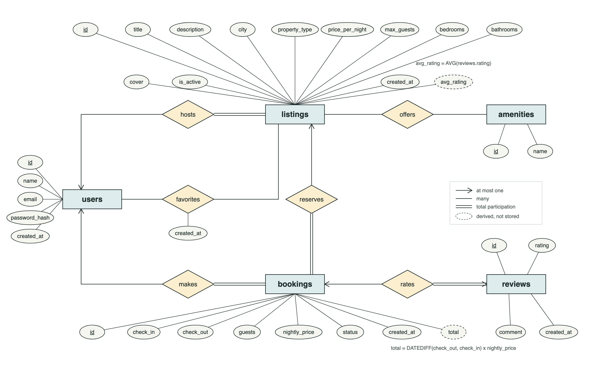

# Lantern Stays

COMP3278 final project: a short-stay booking web app (in the spirit of Airbnb) built on **Node.js + Express + MySQL**, with a plain HTML/CSS/JavaScript front end (no build step).

Guests search for places that are free on their dates, book them, change or cancel bookings, review finished stays and save favourites. Hosts publish listings, edit, pause or delete them, and see bookings and revenue per listing. A built-in **SQL inspector** shows the exact SQL statements behind every click.

---

## 1. Requirements

| Software | Version | Check with |
| --- | --- | --- |
| Node.js | 18 or newer | `node -v` |
| MySQL Server | 8.0 or newer (running) | `mysql --version` |

Tested with Node.js 26 and MySQL 9.0. No other software is needed; the app works offline.

## 2. Installation and run instructions

Run every command from this project folder (the one containing `package.json`).

**Step 1 - install the dependencies**

```bash
npm install
```

**Step 2 - create the configuration file**

```bash
cp .env.example .env
```

On Windows use `copy .env.example .env`. Then open `.env` and put your MySQL password after `DB_PASSWORD=` (see [section 3](#3-database-setup-configuration-and-initial-data) for all settings).

**Step 3 - create the database and load the initial data**

```bash
npm run db:setup
```

Expected output:

```text
Connecting to MySQL at 127.0.0.1:3306 as "root" ...
  ran db/schema.sql
  ran db/seed.sql

Database "lantern_stays" is ready:
  users                8 rows
  listings            21 rows
  amenities           12 rows
  listing_amenities  109 rows
  bookings            43 rows
  reviews             24 rows
  favorites           11 rows
```

**Step 4 - start the app**

```bash
npm start
```

Then open <http://localhost:3000>. Stop the server with `Ctrl + C`.

**Step 5 - log in with a demo account**

Click **Log in** and press one of the demo buttons, or type the details yourself:

| Role in the demo | Email | Password |
| --- | --- | --- |
| Guest with past and upcoming trips | `alice@example.com` | `lantern123` |
| Host with five listings | `ben@example.com` | `lantern123` |

All eight seeded accounts (`alice`, `ben`, `chloe`, `daniel`, `emma`, `farid`, `grace`, `hiro` `@example.com`) use the same password. You can also create a new account with **Sign up**.

## 3. Database setup, configuration and initial data

### Configuration (`.env`)

| Setting | Default | Meaning |
| --- | --- | --- |
| `PORT` | `3000` | Port of the web server |
| `DB_HOST` | `127.0.0.1` | MySQL host |
| `DB_PORT` | `3306` | MySQL port |
| `DB_USER` | `root` | MySQL account (needs permission to create a database) |
| `DB_PASSWORD` | *(empty)* | Password of that account |
| `DB_NAME` | `lantern_stays` | Database the app reads. Keep this value: the SQL files create a database with exactly this name |
| `SESSION_SECRET` | sample text | Signs the login cookie; any random string |
| `SQL_INSPECTOR` | `true` | Set to `false` to stop sending executed SQL to the browser |

### What `npm run db:setup` does

It runs two SQL files with the account from `.env`:

1. [`db/schema.sql`](db/schema.sql) - `CREATE DATABASE IF NOT EXISTS lantern_stays`, then drops and recreates the 7 tables and 1 view.
2. [`db/seed.sql`](db/seed.sql) - inserts the initial data.

### Alternative: set up with the `mysql` client

If you prefer not to use the script, run the same two files yourself:

```bash
mysql -u root -p < db/schema.sql
mysql -u root -p < db/seed.sql
```

In Windows PowerShell (which has no `<` redirection), use:

```bash
mysql -u root -p -e "source db/schema.sql; source db/seed.sql"
```

### Initial data

| Table | Rows | Contents |
| --- | --- | --- |
| `users` | 8 | 4 hosts and 4 guests (any account can do both) |
| `listings` | 21 | Hong Kong 6, Tokyo 4, Seoul 3, Taipei 3, Bangkok 3, Singapore 2 |
| `amenities` | 12 | Wifi, Kitchen, Pool, Sea view, ... |
| `listing_amenities` | 109 | Which listing offers which amenity |
| `bookings` | 43 | Past, upcoming and cancelled stays |
| `reviews` | 24 | One per finished stay (one stay is left unreviewed on purpose) |
| `favorites` | 11 | Saved listings |

All dates in the seed file are **relative to the day you load it** (`CURDATE() + INTERVAL n DAY`), so there are always upcoming trips to change or cancel and finished trips to review.

### Reset the data

Run `npm run db:setup` again at any time. It rebuilds every table and reloads the initial data.

### Check the database by hand

```bash
mysql -u root -p lantern_stays -e "SHOW FULL TABLES; SELECT city, COUNT(*) AS listings FROM listings GROUP BY city;"
```

## 4. What you can do in the app (CRUD)

| Operation | In the app | Main SQL | Code |
| --- | --- | --- | --- |
| **Create** | Sign up | `INSERT INTO users` | `src/routes/auth.js` |
| | Reserve a stay | transaction: `SELECT ... FOR UPDATE`, overlap check, `INSERT INTO bookings` | `src/routes/bookings.js` |
| | Write a review | `INSERT INTO reviews ... SELECT` (only for my finished stay) | `src/routes/bookings.js` |
| | Publish a listing | transaction: `INSERT INTO listings` + `INSERT INTO listing_amenities` | `src/routes/host.js` |
| | Save a favourite | `INSERT IGNORE INTO favorites` | `src/routes/favorites.js` |
| **Read** | Search by city, dates, guests, price, type, amenities | joins + `NOT EXISTS` (availability) + relational division (all amenities) | `src/routes/listings.js` |
| | Listing page with reviews | 4 `SELECT`s with joins | `src/routes/listings.js` |
| | My trips | join with derived total (`DATEDIFF * nightly_price`) | `src/routes/bookings.js` |
| | Host dashboard | `LEFT JOIN` + `GROUP BY` with `COUNT` / `SUM` | `src/routes/host.js` |
| **Update** | Change dates or guests of a booking | transaction with overlap re-check, `UPDATE bookings` | `src/routes/bookings.js` |
| | Cancel a booking | `UPDATE bookings SET status = 'cancelled'` | `src/routes/bookings.js` |
| | Edit a review | multi-table `UPDATE reviews JOIN bookings` | `src/routes/bookings.js` |
| | Edit / pause a listing | `UPDATE listings` | `src/routes/host.js` |
| **Delete** | Remove a cancelled booking | `DELETE FROM bookings` | `src/routes/bookings.js` |
| | Delete a review | multi-table `DELETE` | `src/routes/bookings.js` |
| | Delete a listing | `DELETE FROM listings` (blocked by a foreign key if it has bookings) | `src/routes/host.js` |
| | Remove a favourite | `DELETE FROM favorites` | `src/routes/favorites.js` |

### SQL inspector

Press the dark **SQL** button in the bottom-left corner. Every action then lists the statements the server sent to MySQL: the SQL text with `?` placeholders, the bound parameters, the rows returned or affected, and `START TRANSACTION` / `COMMIT` / `ROLLBACK`. Statements are colour-coded as CREATE, READ, UPDATE or DELETE.

### A five-minute walkthrough

1. Home page: search **Hong Kong** with dates about two weeks ahead. Listings already booked on those dates are missing from the results.
2. Open a listing, press **Reserve**, log in as Alice. The booking appears under **Trips**.
3. In **Trips**: change the dates, cancel the booking, remove it; write, edit and delete a review on a past stay.
4. Log out, log in as Ben, open **Host**: create a listing, edit its price, pause it, delete it.
5. Try to delete a listing that has bookings: MySQL rejects it (foreign key) and the app explains why.

## 5. Database design

The ER diagram is in [`docs/er-diagram.png`](docs/er-diagram.png) (vector version: `docs/er-diagram.svg`).



| Table | Purpose | Key constraints |
| --- | --- | --- |
| `users` | Accounts | `email` is `UNIQUE` |
| `listings` | Places to stay; each has one host | FK `host_id` to `users`; `CHECK` on price and guests |
| `amenities` | Lookup list of amenities | `name` is `UNIQUE` |
| `listing_amenities` | M:N between listings and amenities | composite PK; both FKs `ON DELETE CASCADE` |
| `bookings` | A guest reserves a listing for a date range | FKs to `listings` and `users`; `CHECK (check_out > check_in)` |
| `reviews` | 1:1 with bookings | `booking_id` is `UNIQUE`; `CHECK (rating BETWEEN 1 AND 5)` |
| `favorites` | M:N between users and listings | composite PK; both FKs `ON DELETE CASCADE` |
| `listing_ratings` (view) | Average rating and review count per listing | |

The booking total and a listing's average rating are derived attributes: they are computed in SQL, never stored.

The most important SQL statements are explained one by one in [`docs/key-sql.md`](docs/key-sql.md).

## 6. Project structure

```text
lantern-stays/
├── README.md
├── package.json           dependencies and npm scripts
├── .env.example           configuration template (copy to .env)
├── server.js              Express app: sessions, routes, error handling
├── db/
│   ├── schema.sql         database, tables, constraints, view
│   └── seed.sql           initial data
├── scripts/
│   ├── setup-db.js        "npm run db:setup": runs the two SQL files
│   └── make-covers.js     optional: regenerates the cover illustrations
├── src/
│   ├── config.js          reads .env
│   ├── db.js              connection pool, prepared statements, transactions, SQL log
│   ├── auth.js            password hashing (scrypt) and login check
│   ├── validate.js        input validation helpers
│   ├── constants.js       property types, cover names, maximum stay length
│   ├── errors.js          HttpError (an error with an HTTP status)
│   └── routes/            auth, listings, bookings (+ reviews), favorites, host
├── public/                the web app served to the browser
│   ├── index.html
│   ├── css/styles.css
│   ├── js/                app shell, API client, SQL inspector, one file per page
│   └── img/covers/        listing cover illustrations (SVG)
└── docs/
    ├── er-diagram.png / .svg
    └── key-sql.md
```

Dependencies: `express` (web server), `mysql2` (MySQL driver), `express-session` (login sessions), `dotenv` (reads `.env`).

## 7. Troubleshooting

| Message | Fix |
| --- | --- |
| `MySQL rejected the login` / `Access denied` | `DB_USER` or `DB_PASSWORD` in `.env` is wrong |
| `Could not reach MySQL` / `ECONNREFUSED` | Start the MySQL server; check `DB_HOST` and `DB_PORT` |
| `Cannot use the database ... Unknown database` or `Table ... doesn't exist` when running `npm start` | Run `npm run db:setup` first |
| `EADDRINUSE: address already in use :::3000` | Another program uses port 3000; change `PORT` in `.env` |
| A `CHECK` constraint is not enforced | MySQL older than 8.0.16 ignores `CHECK`; use MySQL 8.0 or newer |

Security notes: all SQL uses prepared statements with `?` placeholders, passwords are stored as salted scrypt hashes, and the session cookie is `HttpOnly`.
